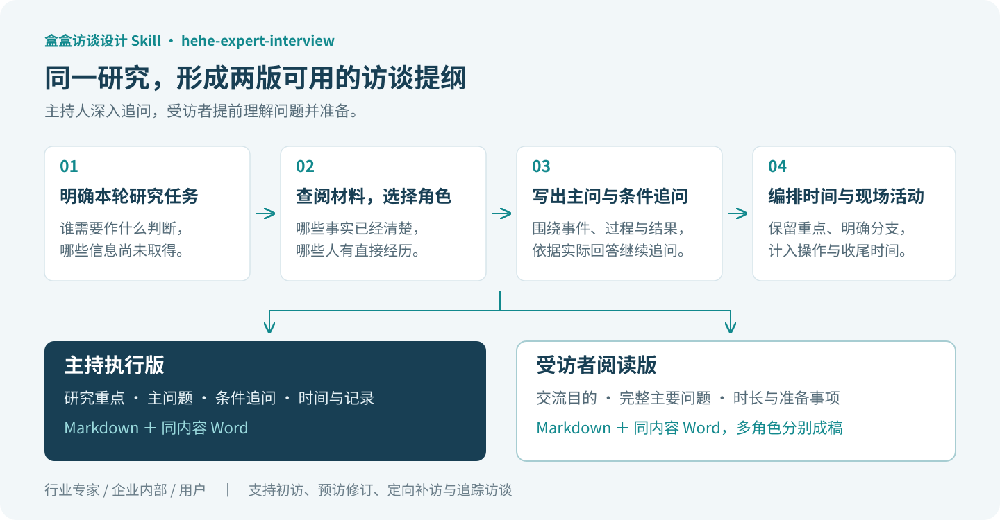
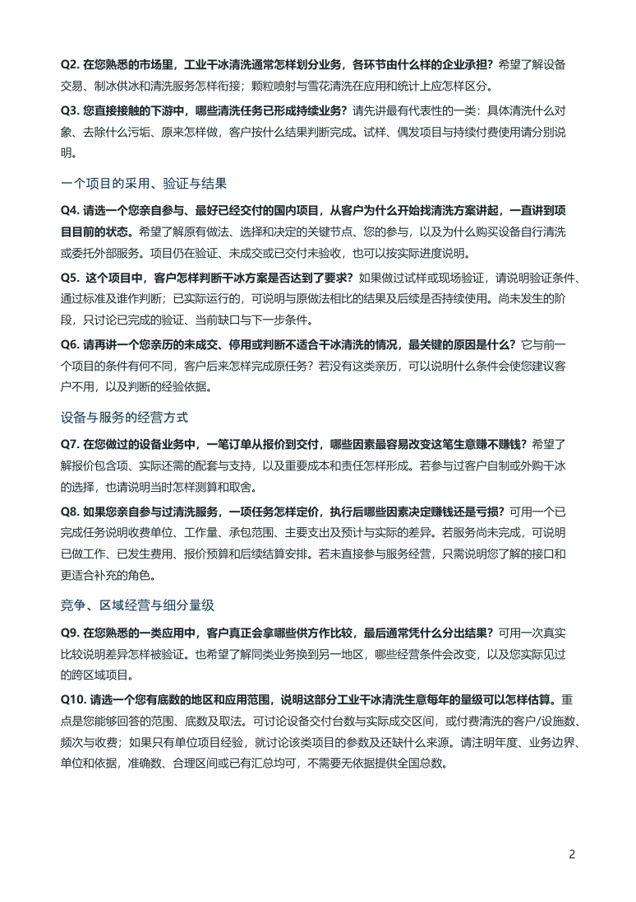
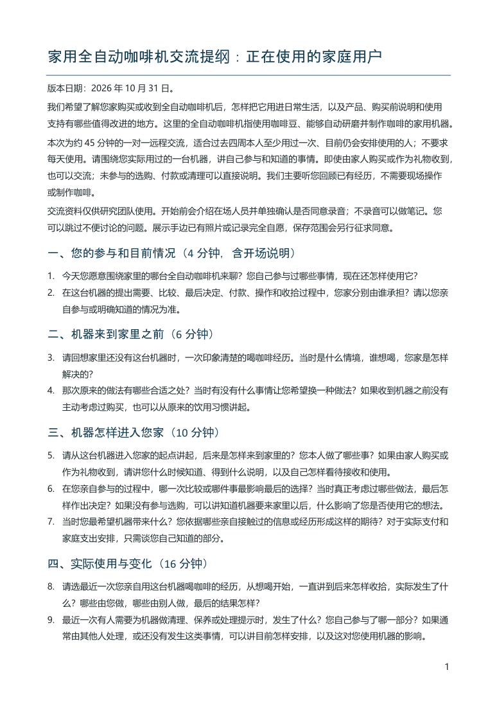

# 盒盒访谈设计 Skill

> 把研究需求，变成主持人能够深入追问、受访者能够提前理解和准备的访谈提纲。

[](LICENSE)
[](https://agentskills.io/)
[](CHANGELOG.md)
[](#安装与开始使用)

**`hehe-expert-interview` 是盒子原创的独立访谈设计 Skill。** 它支持行业专家、企业内部人员和普通用户三类访谈：先理解研究要支持的判断，查阅已有材料，再确定向谁了解什么、如何提问和追问、怎样安排时间，最终交付主持执行版与受访者阅读版。

你可以从一段研究需求开始，也可以提供产品介绍、经营数据、原有提纲或前几场访谈的反馈。需要完整设计时形成两版文稿；只需修几道题、补访某个问题或沿用指定格式时，就按本次范围工作。

<p align="center">
  <a href="https://github.com/hexiaofeier/hehe-expert-interview/releases/latest"><strong>📦 下载发布版</strong></a>
  &nbsp; · &nbsp;
  <a href="skills/hehe-expert-interview/SKILL.md"><strong>📖 阅读 Skill</strong></a>
  &nbsp; · &nbsp;
  <a href="#提纲效果与完整样稿"><strong>📝 查看实际样稿</strong></a>
  &nbsp; · &nbsp;
  <a href="#直接这样使用"><strong>🚀 开始使用</strong></a>
</p>

## 同一份研究设计，服务访谈前和访谈中

好的访谈提纲既要让主持人知道如何深入，也要让受访者提前看懂将讨论哪些事情，判断自己能回答什么、需要回忆哪些经历或准备什么资料。

本 Skill 将这两种用途分开交付：受访者收到具体、完整的主要问题；主持人保留研究重点、条件追问、材料展示、时间取舍和记录提示。多人、多角色项目按各自经历分别设计，让每个人回答自己真正知道的部分。



| 文稿 | 主要使用者 | 核心内容 | 默认格式 |
|---|---|---|---|
| **主持执行版** | 研究人员、访谈主持人 | 研究目标、受访条件、模块目的与时间、主问题、条件追问、敏感问题处理、记录字段及访后待核事项 | Markdown＋同内容 Word |
| **受访者阅读版** | 行业专家、企业人员、普通用户 | 交流目的、预计时长与方式、按主题展开的完整主要问题、适合回答的经历及准备事项 | Markdown＋同内容 Word |

两版沿用同一研究对象和核心主题，问法可按读者合并改写；每一版的 Markdown 和 Word 内容保持一致。多角色的阅读稿分别成文，主持稿可以合册。

## 三种访谈模式，按实际经历分配问题

| 模式 | 适合了解的内容 | 提问时关注什么 |
|---|---|---|
| **行业专家** | 行业分工、客户采用、竞争、经营机制、市场参数及变化 | 专家实际接触的地区、企业、项目和时期，以及判断依据 |
| **企业内部** | 战略与经营、研发与交付、销售与采购、组织流程及决策 | 本人职责、参与环节、所看记录；不同部门共同核对同一事项 |
| **用户** | 生活或工作任务、购买与使用、替代办法、停用及产品体验 | 购买、付款、决定和使用由谁承担；不同经历分别进入对应题组 |

三种模式可以在同一个项目中组合。例如研究企业软件的续约价值，可以分别询问使用者的工作结果、采购人员的替换与预算决定，以及供应方的实际交付。

## 研究重点怎样落实到问题中

### 先读材料，再安排有限的访问时间

研究 brief、产品资料、组织职责、经营表、前访记录和原提纲，分别帮助确定研究对象、知情角色和待了解事项。必要时补查公开背景，把访谈留给材料尚未解释清楚的过程、差异和判断。

已有明确回答的基础信息用于定制问题；有冲突的信息则转成具体核问。关键条件集中澄清，其他可调整细节说明假设后继续起草。

### 主问题讲清对象，追问跟着真实回答展开

围绕一次实际事件，追问当时的需求、原来做法、采取的行动、参与者、取舍和结果。不同经历设置清楚分支，例如已经使用、尚未启用、正在比较、停用后由家人继续使用。

需要经营数字时，追清期间、范围、单位、分母和来源。需要技术或商业验证时，区分测试、意向、合同、交付、验收、收入和回款等实际阶段。数值不便披露时，可以取得区间、比例、匿名案例或后补资料。

### 产品体验有活动安排，多人讨论有表达时间

概念展示、实物试用、屏幕演示、亲子活动或座谈，需要写清材料版本、出示顺序、任务、帮助方式、观察和追问，并把操作与换样计入时间。未提示的认知与需求探索放在相关材料展示之前。

提纲区分必问、条件追问和可删补充，留出热身、补问与收尾。超过容量时调整主题或分轮；预访后再依据真实理解、回答深度和用时修订。

## 提纲效果与完整样稿

以下三组均为 **模拟研究设计**，用于展示提纲内容与文件交付方式，尚未实施访谈。图片来自生成的 Word 文稿页面；完整文件可下载后阅读、批注和修改。

### 行业专家初访｜中国工业干冰清洗

围绕行业业务分类、客户采用、亲历项目、设备与服务经营、竞争量级以及变化依据，设计约 75 分钟的专家初访。受访者阅读稿列出完整主要问题，方便专家提前判断熟悉范围并回忆项目。

[](docs/images/expert-reader-page_CO.png)

| 文稿 | 阅读 Markdown | 下载 Word |
|---|---|---|
| 受访者阅读版 | [专家访前阅读稿](examples/industrial-cleaning/20261031_工业干冰清洗_行业专家提纲_受访者阅读版_CO.md) | [Word 文稿](examples/industrial-cleaning/20261031_工业干冰清洗_行业专家提纲_受访者阅读版_CO.docx) |
| 主持执行版 | [主问、追问及主持安排](examples/industrial-cleaning/20261031_工业干冰清洗_行业专家提纲_主持执行版_CO.md) | [Word 文稿](examples/industrial-cleaning/20261031_工业干冰清洗_行业专家提纲_主持执行版_CO.docx) |

### 企业人员访谈｜工业空压机预测性维护

同一研究分别面对设备操作人员、维修负责人和采购参与者。维修负责人阅读稿围绕实际故障、维护安排、技术判断与结果展开；其他岗位承担其职责内的问题，保留共同对象与比较主题。

**查看维修负责人样稿：** [Markdown 阅读稿](examples/industrial-maintenance/20261031_空压机维护_受访者版_维修负责人_CO.md) · [下载同内容 Word](examples/industrial-maintenance/20261031_空压机维护_受访者版_维修负责人_CO.docx)。


其他岗位与合并主持稿：[操作使用人员](examples/industrial-maintenance/20261031_空压机维护_受访者版_操作使用人员_CO.md) · [采购参与者](examples/industrial-maintenance/20261031_空压机维护_受访者版_采购参与者_CO.md) · [合并主持执行稿](examples/industrial-maintenance/20261031_空压机预测维护_访谈提纲_CO.md)。对应 Word 同在该示例目录。

### 普通用户访谈｜家用全自动咖啡机

研究家庭购买、使用与停用经历，分别设计“正在使用”“闲置退货”“考虑未买”三路，预计每路约 45 分钟。主持稿有共同主题和条件分支，受访者按自身经历收到对应阅读稿。

[](docs/images/coffee-reader-page_CO.png)

| 文稿 | 阅读 Markdown | 下载 Word |
|---|---|---|
| 正在使用的用户 | [受访者阅读稿](examples/home-coffee/20261031_家用咖啡机_用户提纲_正在使用_受访者版_CO.md) | [Word 文稿](examples/home-coffee/20261031_家用咖啡机_用户提纲_正在使用_受访者版_CO.docx) |
| 闲置、停用或退货的用户 | [受访者阅读稿](examples/home-coffee/20261031_家用咖啡机_用户提纲_闲置退货_受访者版_CO.md) | [Word 文稿](examples/home-coffee/20261031_家用咖啡机_用户提纲_闲置退货_受访者版_CO.docx) |
| 认真考虑、尚未购买的用户 | [受访者阅读稿](examples/home-coffee/20261031_家用咖啡机_用户提纲_考虑未买_受访者版_CO.md) | [Word 文稿](examples/home-coffee/20261031_家用咖啡机_用户提纲_考虑未买_受访者版_CO.docx) |
| 三路合并主持稿 | [共用主线与经历分支](examples/home-coffee/20261031_家用咖啡机_用户提纲_主持执行版_CO.md) | [Word 文稿](examples/home-coffee/20261031_家用咖啡机_用户提纲_主持执行版_CO.docx) |

例如闲置退货稿第 8 题根据经历分别进入：亲自用过的，回顾停用前一次使用；从未用起来的，讲实际停在哪一步；家人用过而本人未操作的，讲自己接收、安排或处置机器的事件。这样的分流保留共同研究主题，同时让问题落在受访者亲历的事情上。

## 直接这样使用

可以用自然语言提出任务：

```text
帮我设计工业干冰清洗的行业专家访谈提纲。
目的是了解这个行业的业务分类、客户采用和设备及服务的盈利条件。
先查阅必要背景，选择有直接项目经历的专家，安排约75分钟。
交付主持执行版和受访者阅读版，各含Markdown和同内容Word。
```

在 Codex 中可以显式调用：

```text
使用 $hehe-expert-interview，为家用全自动咖啡机研究设计访谈提纲。
分别访问正在使用、闲置退货、认真考虑但未买的家庭用户，每场约45分钟。
重点了解具体购买和使用经历，以及产品、购买说明和使用支持的改进方向。
提供一份合并主持稿和三份受访者阅读稿，各含Markdown与Word。
```

已有提纲可以直接修改：

```text
使用 $hehe-expert-interview，依据这份原提纲和前三场预访反馈修订。
保留跨访共同比较项，优先处理答不上、重复、经历分支不成立和超时的题。
同步修改受影响的主持稿、受访者稿及Word版本，原稿保留。
```

只做定向补访时，提供前访记录与尚未清楚的事项：

```text
使用 $hehe-expert-interview，设计一份15分钟补访提纲。
只核对上次谈到的采购预算和合同交付范围之间的差异，
注明需要补的具体资料，不重复初访已经清楚的公司背景。
```

## 安装与开始使用

下载 [最新 Release](https://github.com/hexiaofeier/hehe-expert-interview/releases/latest)，或克隆仓库：

```bash
git clone https://github.com/hexiaofeier/hehe-expert-interview.git
```

将完整的 `skills/hehe-expert-interview/` 文件夹复制到客户端的 Skills 目录。保留其中的 `references/`、`examples/` 和 `agents/`，新开会话后使用。

| 客户端 | 常见用户级目录 | 安装后的入口 |
|---|---|---|
| Codex | `~/.codex/skills/` 或客户端配置目录 | `~/.codex/skills/hehe-expert-interview/SKILL.md` |
| Claude Code | `~/.claude/skills/` | `~/.claude/skills/hehe-expert-interview/SKILL.md` |

**只需安装这一个 Skill。** 本仓库可独立使用，不要求安装行业研究组合包、采集 Skill 或其他文档 Skill。Agent 使用当前环境可用的材料读取与搜索能力；制作 Word 时使用可用的文档工具。

Skill 本身是 Markdown 方法文件，随包提供参考和教学示例，没有固定的代码运行依赖，也未附自动生成 Word 的专用脚本。若制作端当前无法生成 Word，先交付已经完成的文本并明确尚缺的 Word 文件；阅读已有样稿只需 Markdown 阅读器或兼容 `.docx` 的文字处理软件。

## 仓库内容

```text
hehe-expert-interview/
├── README.md
├── LICENSE
├── CHANGELOG.md
├── release-manifest.json
├── docs/images/                     # 设计流程和样稿实图
├── examples/                        # 三类模拟任务的MD与Word成稿
└── skills/hehe-expert-interview/
    ├── SKILL.md
    ├── agents/openai.yaml
    ├── references/                  # 五份方法参考
    └── examples/                    # 三份教学设计示例
```

运行版保留研究任务、受访角色、主问追问、用户分流、产品活动、时间编排、双版本交付和预访修订。仓库根目录的完整样稿用于查看成稿效果；Skill 内的教学示例用于帮助 Agent 理解设计方法。

## 2026.11.01 · 首次独立公开

- **三种访谈模式：** 行业专家、企业内部和普通用户，可按项目组合角色。
- **双版本交付：** 主持执行版与受访者阅读版，各有 Markdown 和同内容 Word。
- **完整受访者问题：** 交流对象能够提前判断知情范围，回忆具体经历并准备必要资料。
- **可执行的访问安排：** 条件追问、材料展示、活动时间、优先级和收尾共同编排。
- **已有设计继续使用：** 支持局部修题、预访修订、补访和追踪，保留共同比较主题。
- **实际样稿随仓库提供：** 工业维护、工业干冰清洗与家用咖啡机三组模拟设计，包含可下载 Word。

本 Skill 承担访谈设计与提纲修订。招募、实际访问、回收材料验收、编码分析和研究报告属于后续工作。当前样稿已完成文稿及文件检查，实际理解与访问时长由项目预访继续校准。

## 发布文件检查

仓库校验器只使用 Python 标准库，不是运行 Skill 的必备依赖：

```bash
python scripts/validate_release_CO.py
```

它核对唯一 Skill 入口、10份运行文件及摘要、随包链接、完整样稿和公开边界。

## 许可证与反馈

本项目采用 [MIT License](LICENSE)。欢迎通过 [Issue](https://github.com/hexiaofeier/hehe-expert-interview/issues) 反馈具体问题，最好说明研究任务、受访角色、出问题的题目和希望取得的信息；请勿附未获授权的个人信息或企业内部材料。
